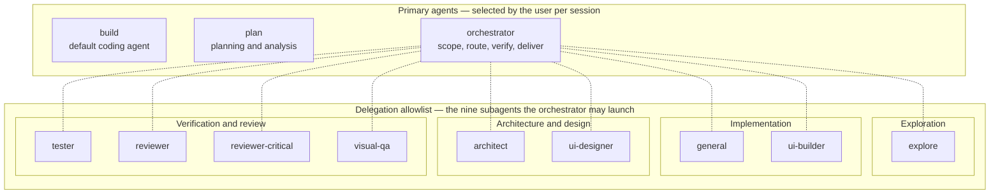

# opencode-orchestrator

A delegation-based engineering workflow for **OpenCode V2**: one orchestrator agent owns scope, routing, verification, and delivery, while specialists with varying tool access handle exploration, implementation, review, testing, architecture, and UI/UX.

This repository contains:

```text
agents/                  8 agent prompts (Markdown, copied verbatim from a working setup)
docs/architecture.md     How the two-layer design fits together
docs/models.md           Exact provider/model/variant mapping and conceptual tiers
docs/adding-an-agent.md  How to add a new agent safely
opencode.example.json    Sanitized reference configuration (models + permissions)
CONTRIBUTING.md
LICENSE                  MIT, © 2026 José Luis Sánchez Vázquez
```

The configuration schema targets **OpenCode V2** (`agents` map, list-form `permissions`, `default_agent`). It was verified against the official V2 documentation (opencode.ai/v2/docs) on **2026-10-28**, and the reference setup ran `opencode v2.2.0`. V1's singular `agent`/`permission` keys are deprecated and not used here.

## Agent roster

The roster is exactly the reference setup: 4 built-in OpenCode agents (configured) plus 8 custom agents (prompts in `agents/`, models/permissions in config). **No other agents exist in this repository.**

| Agent | Kind | Responsibility | Model in reference config | Configured restrictions |
| --- | --- | --- | --- | --- |
| `build` | built-in, primary | Default coding agent (stays the default) | `opencode-go/deepseek-v4.1-flash#low` | None (built-in defaults) |
| `plan` | built-in, primary | Planning and analysis | `opencode-go/deepseek-v4.1-flash#high` | Built-in restrictions (no normal file edits) |
| `orchestrator` | custom, primary | Scope, delegation, integration, verification, delivery | No override — runs on the session model the user picks | None; delegation limited by its subagent allowlist |
| `general` | built-in, subagent | Scoped non-UI implementation | `opencode-go/mimo-v2.6-flash` | None (may edit) |
| `explore` | built-in, subagent | Code search and call tracing | `opencode-go/mimo-v2.6-flash` | Built-in: no edits |
| `architect` | custom, subagent | Hard system-level decisions and diagnoses | `openai/gpt-6.1-sol#high` | Edit + shell denied |
| `tester` | custom, subagent | Reproduce issues, run checks, report results | `opencode-go/mimo-v2.6-flash` | Edit tools denied; **shell unrestricted** |
| `reviewer` | custom, subagent | Independent routine code review | `opencode-go/deepseek-v4.1-flash#high` | Edit + shell denied |
| `reviewer-critical` | custom, subagent | High-stakes audit (security, integrity, migrations) | `openai/gpt-6.1-terra#high` | Edit + shell denied |
| `ui-designer` | custom, subagent | Design brief and visual direction | `openai/gpt-6.1-terra#medium` | Edit + shell denied |
| `ui-builder` | custom, subagent | Implement approved UI in the existing stack | `opencode-go/mimo-v2.6-flash` | None in config — its "UI files only" scope is prompt-level |
| `visual-qa` | custom, subagent | Critique of the **rendered** interface | `openai/gpt-6-luna#high` | Edit + shell denied |

"Denied" here means the matching **tools** are denied — `edit` covers the write/edit/patch tools and `shell` covers bash. Agents that deny both still keep read/search/web tools; this is least-privilege scoping, not a read-only sandbox. Model availability depends on your providers; see [docs/models.md](docs/models.md).

## Workflow

This is a **decision flow, not a pipeline**: every gate is evaluated per task, most requests touch only a handful of nodes, and none of the delegations happen unless the matching gate says so. The orchestrator handles small, well-localized work itself and launches a subagent only where value is clear.

### Decision flow

```mermaid
flowchart TD
    U([User request]) --> SC[Scope: objective, constraints,<br/>acceptance criteria, risks]
    SC --> SMALL{"Small and well-localized?"}
    SMALL -->|yes: question or explanation| ANS[Answer directly<br/>no change made]
    ANS --> RPT
    SMALL -->|yes: simple change| DIR[Handled directly<br/>no subagents launched]
    DIR --> CHK
    SMALL -->|no| LOC{"Unknown code locations<br/>or existing behavior?"}
    LOC -->|yes| E[explore<br/>bounded search questions]
    LOC -->|no| ARCH
    E --> ARCH{"System-level uncertainty?<br/>boundaries, data model, complex migration,<br/>concurrency, security-sensitive design"}
    ARCH -->|yes| A[architect<br/>decision or diagnosis, no edit/shell]
    ARCH -->|no| IMP
    A --> IMP{"Implementation route"}
    IMP -->|scoped non-UI work| G[general<br/>bounded implementation]
    IMP -->|UI plus backend/domain logic| BOTH[Coordinate non-overlapping scopes:<br/>general = backend/domain,<br/>ui-builder = presentation]
    IMP -->|substantial UI, direction unclear| UD[ui-designer<br/>actionable design handoff]
    IMP -->|substantial UI, direction clear| UB[ui-builder<br/>implements in the existing stack]
    UD --> UB
    BOTH --> G
    BOTH --> UB
    G --> CHK
    UB --> CHK
    CHK{"Smallest relevant checks pass?"}
    CHK -->|fail| FN
    CHK -->|pass| REP{"Reproduce an issue or run<br/>broader functional checks?"}
    REP -->|yes| T[tester<br/>edit tools denied; shell unrestricted]
    REP -->|no| REV
    T --> REV{"Material behavior change or<br/>meaningful engineering risk?"}
    REV -->|yes| R[reviewer<br/>independent routine review]
    REV -->|no| VIS
    R --> CRIT{"Defects would have serious security, privacy,<br/>financial, data-integrity, or operational<br/>consequences?"}
    CRIT -->|yes: additional audit by impact<br/>and remaining uncertainty| RC[reviewer-critical<br/>additional independent audit]
    CRIT -->|no| VIS
    RC --> VIS{"Substantial visual change?"}
    VIS -->|no| FN
    VIS -->|yes| EV{"Rendered evidence available?<br/>screenshots, running app, preview"}
    EV -->|yes| VQ[visual-qa<br/>assesses actual rendered evidence]
    EV -->|no| NV[Visual review reported as<br/>NOT VERIFIED with manual path]
    VQ --> FN
    NV --> FN
    FN{"Findings to address?"}
    FN -->|no| DONE
    FN -->|yes| FIX[Evaluate findings: fix BLOCKING,<br/>normally fix IMPORTANT, weigh OPTIONAL]
    FIX --> RE[Re-run impacted checks,<br/>reinspect affected UI]
    RE --> DONE
    DONE{"Acceptance criteria met<br/>and evidence in hand?"}
    DONE -->|no, attempts remain| RETRY[Next attempt: narrow the failure<br/>or change the approach]
    RETRY --> IMP
    DONE -->|no, same strategy failed twice| ESC[Stop repeating the same strategy]
    ESC -->|gather new evidence| LOC
    ESC -.->|structural uncertainty| A
    DONE -->|yes| RPT([Final report: changes, checks,<br/>actual evidence, open risks])
```



### Delegation topology

A static map of the subagents the orchestrator may launch. The links mean *"may delegate to"*, not "then": they are drawn undirected only to avoid implying an order, but represent delegation from the orchestrator to those subagents. The role groupings are editorial labels; the config encodes a flat allowlist, not a hierarchy among subagents. `build` and `plan` retain their own default permissions. Nothing here implies priority or that any two subagents run together:



`build` and `plan` are separate **primary** agents: sessions start in one of them, and the orchestrator never delegates to them. The allowlist is enforced in config (`subagent *` denied, then exactly these nine allowed — see [Security](#security)); it cannot spawn anything else.

Ground rules, taken from the agent prompts themselves:

- **Delegation is not reflexive.** Questions, simple explanations, and one-off fixes are handled directly by the orchestrator — an answer-only request exits straight to the final report, with no verification loop to run.
- **`tester` and reviews are impact-based options**, chosen by impact and remaining uncertainty. `reviewer-critical` is an *additional* independent audit for high-consequence risk (serious security, privacy, financial, data-integrity, or operational consequences) — not a routine either/or swap for `reviewer` — and the two are never both launched automatically for routine edits.
- **The UI track is sequential, not automatically parallel.** `visual-qa` inspects the result of `ui-builder`, so it runs after implementation. Only independent *read-only* investigations may run concurrently; concurrent edits to overlapping files are forbidden.
- **Two failed attempts end the loop.** After two unsuccessful attempts with essentially the same strategy the orchestrator stops repeating it: it gathers new evidence, narrows the failure, or consults `architect` for structural issues. For repeated visual failures it first re-examines the design specification, actual screenshots, viewport/state coverage, and implementation differences — and uses `ui-designer` for visual-direction ambiguity, not `architect` by default.
- **Honest evidence is mandatory.** No agent may claim a test passed, a screenshot was captured, or a review happened without evidence. If rendered evidence is unavailable (the reference setup ships the browser MCP server *disabled*), the workflow ends visual assessment at **"VISUAL REVIEW NOT VERIFIED"** with a manual verification path — never with a fabricated approval.

## Setup (OpenCode V2)

This repository never modifies your live configuration; installation is copy-and-merge.

### 1. Install OpenCode V2

Verified install commands from the official V2 docs (2026-10-28):

```sh
# curl
curl -fsSL https://opencode.ai/v2/install | bash
# homebrew
brew install anomalyco/tap/opencode-v2
# npm (postinstall selects the native binary)
npm install -g @opencode/cli
```

`bun`, `pnpm`, `yarn`, `vite+`, AUR, and `mise` variants, plus standalone binaries, desktop apps, and Docker images, are listed in the same docs. Windows package managers are not supported.

### 2. Install the agent prompts

Copy the prompts into the global agent directory — **always back up first and never clobber existing files**:

```sh
mkdir -p ~/.config/opencode/agents            # global agents directory
cp -a ~/.config/opencode/agents ~/.config/opencode/agents.bak   # 1. back up (skip if none yet)
cp -n agents/*.md ~/.config/opencode/agents/                    # 2. no-clobber copy
diff -q agents/ ~/.config/opencode/agents/                      # 3. review the result
```

Or install them into a project's `.opencode/agents/` for per-project use (a nested path like `team/reviewer.md` becomes the agent ID `team/reviewer`). The file name is the agent ID; the frontmatter carries `description` and `mode`, and the Markdown body is the system prompt. Models and permissions are **not** in the Markdown files — they come from the JSON config below.

`cp -n` skips files that already exist instead of overwriting them — and it does so quietly, so always check `diff` afterward. Where a file already exists (for example, a customized `reviewer.md`), do **not** blindly replace it: open both versions, merge the changes you want into your copy, and keep the backup until you are satisfied.

### 3. Configure models and permissions

Copy `opencode.example.json` and merge its `agents` (and optionally `default_agent` and `mcp`) sections into your global `~/.config/opencode/opencode.json` or a project config. Back up the file you are merging into first:

```sh
cp ~/.config/opencode/opencode.json ~/.config/opencode/opencode.json.bak
```

Treat the example as a reference, not a drop-in replacement: merge entry-by-entry so you keep any providers, permissions, or settings you already have.

> **The model IDs are real IDs from the reference setup, not placeholders — but you must configure the matching providers.** The `opencode-go/*` models require an [OpenCode Go](https://opencode.ai/v2/docs/console/go/) subscription; the `openai/*` models require OpenAI credentials. Connect providers in the TUI with `/connect` or through OpenCode Console. Run `opencode models` to see which models *your* account can actually use, and substitute equivalents if needed. Do not invent "tier" model names: `#low`, `#medium`, and `#high` are per-model variants and only work where the model defines them.

The example contains **no MCP servers, no machine-specific paths, and no credentials** — see step 5 for the optional MCP layer.

### 4. Keep `build` as the default; select the orchestrator per session

The example (like the reference setup) sets `"default_agent": "build"`: new sessions still start in the built-in `build` agent, with the orchestrator available on demand. To use the orchestrator in a session, pick it from the agent selector with the **`/agents`** command, or cycle agents forward with **Shift+Tab** (the `agent.cycle` keybind; see the official [keybinds docs](https://opencode.ai/v2/docs/cli/keybinds/) for the current defaults and how to rebind in `cli.json`). If you want the orchestrator as the default instead, change `default_agent` to `"orchestrator"` — per the V2 docs this affects only sessions that have not yet selected an agent and does **not** change existing sessions.

### 5. Optional: MCP servers

Everything in this workflow works without MCP. Two optional, third-party servers are worth considering — review each project's own documentation before adding it. This repository deliberately contains **no machine-specific binary paths, no credentials, and no API keys**: the server commands below resolve from your `PATH` (or via `npx`), and secrets belong in environment variables referenced as `{env:NAME}`, never written into committed config (per the [V2 MCP docs](https://opencode.ai/v2/docs/mcp-servers), verified 2026-10-28).

#### `codebase-memory` (optional, recommended): local code knowledge graph

[codebase-memory-mcp](https://github.com/DeusData/codebase-memory-mcp) indexes a repository into a persistent **local** knowledge graph — functions, classes, call chains, routes, dependencies, change impact — and exposes it as MCP tools. Indexing and queries run on your machine with no hosted service or API key. When the graph is available, agents are instructed to prefer it for code discovery; when it is unavailable or its results are incomplete, they fall back to grep/glob and say so. The workflow is fully functional either way — the graph makes `explore`-style work faster and cheaper, it is never a requirement.

Install per the project's own documentation ([README](https://github.com/DeusData/codebase-memory-mcp#readme), verified 2026-10-28). The official installer detects OpenCode and does **more than write an MCP entry**: depending on client capabilities it may also create or edit `AGENTS.md`, install skills, register Scout/Verify/Auditor agent profiles, and add context hooks alongside the config change. **Back up the files you care about first** (the copy-and-backup discipline from step 2 applies here too), review what it wrote, or skip the installer entirely and configure the server manually with the JSON below. Afterward, ask an agent to *"Index this project"*:

```sh
# macOS / Linux
curl -fsSL https://raw.githubusercontent.com/DeusData/codebase-memory-mcp/main/install.sh | bash
```

Windows PowerShell, manual archive, and package-manager variants (npm, PyPI, Homebrew, and others) are documented in the same README — `npm install -g codebase-memory-mcp` is the npm route.

If you prefer to configure by hand instead of letting the installer write your config, add a `local` server entry pointing at the installed binary (it must be on your `PATH` — the installer's default directory is `~/.local/bin`):

```json
{
  "mcp": {
    "servers": {
      "codebase-memory": {
        "type": "local",
        "command": ["codebase-memory-mcp"]
      }
    }
  }
}
```

#### `chrome-devtools` (optional, disabled by default): rendered evidence for visual QA

[chrome-devtools-mcp](https://github.com/ChromeDevTools/chrome-devtools-mcp) is the official Chrome DevTools MCP server: it drives a live Chrome instance so `visual-qa` can inspect **actual rendered pages** — screenshots, layout at different viewports, console and network state — instead of inferring appearance from source. It requires a Node.js LTS version and current stable Chrome ([requirements](https://github.com/ChromeDevTools/chrome-devtools-mcp#requirements)).

Keep it **disabled until you deliberately authorize browser access**, and know the privacy-relevant defaults documented in the project README: the server exposes the browser instance's content to MCP clients; Google's usage-statistics collection is **enabled by default** (opt out with the `--no-usage-statistics` flag, e.g. `"command": ["npx", "-y", "chrome-devtools-mcp@latest", "--no-usage-statistics"]`); and performance tools may send trace URLs to Google's CrUX API for real-user experience data (opt out with `--no-performance-crux`). Valid OpenCode V2 configuration (schema per the [V2 MCP docs](https://opencode.ai/v2/docs/mcp-servers)):

```json
{
  "mcp": {
    "servers": {
      "chrome-devtools": {
        "type": "local",
        "command": ["npx", "-y", "chrome-devtools-mcp@latest"],
        "disabled": true
      }
    }
  }
}
```

`"disabled": true` keeps the server configured without connecting it; remove the field (or set it to `false`) when you want agents to have browser tools. Enabling an MCP server gives every agent its tools — do it deliberately, and note that the agents' own rules forbid them from enabling disabled servers or installing tools themselves.

**Without rendered evidence, the workflow does not fake it.** Acceptable evidence for `visual-qa` includes browser-tool screenshots, user-provided screenshots of the running app, emulator/device captures, and framework previews. When none is available, the orchestrator performs the checks it can, reports **VISUAL REVIEW NOT VERIFIED**, and provides a reproducible manual verification path.

#### Verify and troubleshoot

See what OpenCode actually loaded (verified against opencode v2.2.0):

```sh
opencode mcp list
```

Each configured server appears with its state — for example `✓ … connected` or `○ … disabled`. If a server is missing from that list or will not connect:

- **The command does not resolve.** Local servers are started as plain commands: `codebase-memory-mcp` must be on the `PATH` OpenCode inherits (the installer's default `~/.local/bin` is not on every shell's `PATH`), and `npx` needs a Node.js LTS install. As a last resort, put the absolute path to the binary in `command` on your machine — and keep it out of commits, per this repository's no-private-paths rule.
- **The config edit is not visible.** Hand-edited `mcp.servers` entries live in whichever config OpenCode actually loads (global `~/.config/opencode/opencode.json` or a project config — `opencode debug config` prints the effective configuration); merge carefully. OpenCode watches config changes; use `/reload` to force a reload if needed.
- **`disabled: true` is not a bug.** A server listed as `○ disabled` is configured but intentionally not connected — that is the recommended starting state for `chrome-devtools`.

### 6. Verify

```sh
opencode debug agents
```

You should get a JSON list of every agent OpenCode sees; check that `orchestrator`, `architect`, `reviewer`, `reviewer-critical`, `tester`, `ui-designer`, `ui-builder`, and `visual-qa` appear alongside the built-ins. (Verified against opencode v2.2.0: there is **no** `opencode agent` subcommand — `opencode debug agents` is the listing command.) For the optional MCP layer, `opencode mcp list` shows each server's state; see [step 5](#5-optional-mcp-servers).

## Security

- **Edit tools ≠ shell.** In OpenCode V2, `edit` gates the write/edit/patch *tools* and `shell` gates bash — they are independent. Denying `edit` does **not** stop an agent that retains shell from changing files (redirection, `sed -i`, package installs, …). `tester` has exactly this profile: no edit tools, **unrestricted shell**.
- **Capability split (config-enforced):** `architect`, `reviewer`, `reviewer-critical`, `ui-designer`, and `visual-qa` deny both `edit` and `shell`. `build`, `orchestrator`, `general`, and `ui-builder` have **no tool restrictions** in this config. `ui-builder`'s "UI files only" scope is **prompt-level, not permission-enforced** — it can technically edit anywhere.
- **Least privilege, not a read-only sandbox.** Agents that deny `edit` and `shell` still keep their other tools (read, glob, grep, webfetch, websearch, …). Never describe a configuration in this repo as "read-only" in the security sense.
- **Delegation allowlist (nine):** the orchestrator's permissions deny `subagent *` and then allowlist exactly nine subagents — the built-ins `general` and `explore`, plus the seven custom subagents `tester`, `reviewer`, `architect`, `reviewer-critical`, `ui-designer`, `ui-builder`, and `visual-qa`. It cannot spawn unlisted agents.
- **Prompt policy is not enforcement.** Four subagent prompts (`architect`, `reviewer`, `reviewer-critical`, `ui-designer`) explicitly tell the agent not to delegate; the others simply don't mention it. The orchestrator prompt forbids claiming tests, screenshots, or reviews without evidence. Per the V2 docs, `hidden` only controls visibility — **permissions are the enforcement mechanism**.
- **Honest limits:** permission enforcement follows OpenCode's documented behavior; verify it for your OpenCode version. The agents run with your user account — "deny" rules bind the agents, not a human operator, and the write-capable agents retain full shell access. Treat this as an agent workflow, not a sandbox.
- **No secrets in this repo:** the example config has no keys, no MCP paths, and no personal data. Keep your real configuration (which may reference local tools) out of commits.

## Limitations

- **Visual QA depends on rendered evidence.** With the browser MCP disabled or no running app, `visual-qa` cannot judge appearance and must report **VISUAL REVIEW NOT VERIFIED**. That is the designed, honest outcome — not a bug, and not something to paper over.
- **Model-dependent behavior.** Routing discipline, review quality, and UI taste vary with the selected models; the orchestrator itself runs on whatever session model the user picks.
- **Variants are per-model.** `#low`/`#medium`/`#high` availability depends on the model and your account; the reference combos are exact, not generic.
- **Optional checks are optional.** The orchestrator may skip `tester` or reviews when it judges risk low — that is a policy choice, not a quality guarantee.
- **Cost and latency.** Parallel subagents multiply token spend; the prompts cap visual correction loops at two before escalating instead of looping forever.
- **Documentation drift.** Syntax here was verified against the V2 docs on 2026-10-28 (runtime v2.2.0). OpenCode's schema evolves — recheck when upgrading.

## Future agent ideas (not implemented)

These are **recommendations only — no such agent exists in this repository**, and none is wired into the orchestrator's allowlist:

- `security-auditor` — read-only dependency/secret/headers audit
- `perf-analyst` — profiling and benchmark interpretation
- `docs-writer` — documentation updates restricted to `docs/**`
- `db-migration-guard` — migration-safety review before schema changes
- `i18n-auditor` — locale coverage and string-consistency checks
- `release-manager` — changelog, tagging, and release-draft assistance

Adding any of them means adding a real agent file and updating the orchestrator's `subagent` allowlist — see [docs/adding-an-agent.md](docs/adding-an-agent.md).

## Further reading

- [docs/architecture.md](docs/architecture.md) — two-layer design, delegation graph, permission semantics
- [docs/models.md](docs/models.md) — the exact model mapping and conceptual tiers
- [docs/adding-an-agent.md](docs/adding-an-agent.md) — extend the roster safely
- [CONTRIBUTING.md](CONTRIBUTING.md)

## License

[MIT](LICENSE) © 2026 José Luis Sánchez Vázquez.
